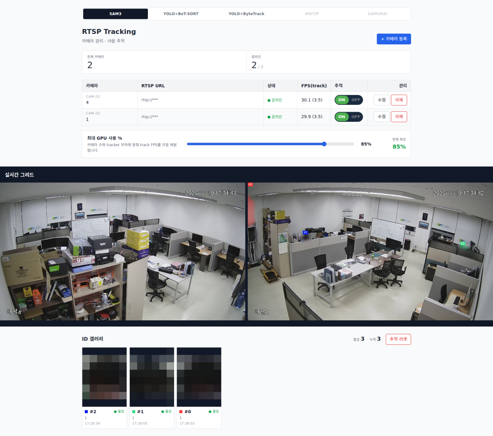

# rtsp-tracking



# 설치 · 실행 (setup 스크립트)

```bash
git clone https://github.com/jskim1102/rtsp-tracking rtsp-tracking
cd rtsp-tracking
```

| 운영체제 | 실행 |
|---|---|
| Linux · macOS | `./setup.sh` |
| Windows | `setup.cmd` 더블클릭 |

접속 : `http://localhost:<FRONTEND_PORT>`

* RTSP 카메라를 등록·수정·삭제하고, 영상은 MediaMTX 가 브라우저에 WebRTC(WHEP)로 실시간 전달.
* 화면 위 탭으로 추적기 선택 — SAM3 · YOLO+BoT-SORT · YOLO+ByteTrack.
* 선택한 추적기가 영상 속 사람을 찾아 사람마다 ID 를 붙이고, 영상 위에 ID 와 윤곽(마스크)으로 표시.
* 처음 나타난 사람은 아래 ID 갤러리에 첫 모습 이미지로 기록 ("추적 리셋" 으로 비움).
* 영상 경로와 추적 경로 분리 — 추적이 느려져도 영상은 끊김 없음.
* 카메라별 추적 켜기 · 끄기 (새로 등록한 카메라는 켜짐).
* 카메라 수와 GPU 부하에 맞춰 추적 속도 자동 조절 (최대 GPU 사용 % 슬라이더).
* `docker compose` 한 번으로 **backend + frontend + MediaMTX 세 컨테이너** 동시 실행.
* NVIDIA GPU 가 있으면 GPU, 없으면 CPU 로 추적.

# 추적기 · 모델

| 추적기 | 모델 |
|---|---|
| SAM3 | `facebook/sam3` (Hugging Face) |
| YOLO+BoT-SORT | `yolo26n-seg` + BoT-SORT |
| YOLO+ByteTrack | `yolo26n-seg` + ByteTrack |

* 한 번에 켜지는 추적기는 하나 (탭을 바꾸면 전체 카메라가 그 추적기로 전환).
* MOTIP · SAMURAI 탭은 자리만 있음 (아직 선택 불가).
* SAM3 는 접근 승인이 필요한 모델 — Hugging Face 에서 `facebook/sam3` 접근을 승인받은 계정의 토큰(`HF_TOKEN`) 필요.
* 토큰 없이 설치하면 setup 이 처음 켜지는 추적기를 YOLO+BoT-SORT 로 지정.
* 모델 파일은 처음 쓸 때 공식 배포처에서 자동 다운로드 (`weights.txt` 참고).
* Docker 에서는 받은 모델을 볼륨에 보관 — 컨테이너를 다시 만들어도 재다운로드 없음.

# 환경변수 (`.env`)

* setup 이 `.env.example` 을 복사해 `.env` 생성, 포트·비밀번호 자동 입력.
* 값을 바꿀 때만 직접 수정 후 setup 다시 실행 (frontend 가 포트·비밀번호를 빌드 때 넣으므로 다시 빌드 필요).
* 비밀번호 · 토큰이 들어가므로 이 파일은 공유 금지.

| 변수 | 값 | 설명 |
|---|---|---|
| `FRONTEND_PORT` | 자동 | 웹페이지 포트 (브라우저 접속 주소) |
| `BACKEND_PORT` | 자동 | 백엔드 API 포트 (브라우저가 직접 접속) |
| `MEDIAMTX_WEBRTC_PORT` | 자동 | MediaMTX 영상 연결 포트 |
| `MEDIAMTX_ICE_UDP_PORT` | 자동 | MediaMTX 영상 데이터 포트 |
| `MEDIAMTX_RTSP_PORT` | 자동 | MediaMTX RTSP 재송출 포트 |
| `MEDIAMTX_API_PORT` | 자동 | MediaMTX 제어 포트 |
| `MEDIAMTX_BACKEND_PASS` | 자동&nbsp;(무작위) | MediaMTX 제어용 비밀번호 |
| `MEDIAMTX_VIEWER_PASS` | 자동&nbsp;(무작위) | 영상 시청용 비밀번호 |
| `MEDIAMTX_WEBRTC_HOST` | setup&nbsp;이&nbsp;질문 | 브라우저가 이 PC 에 닿는 주소 전부 (쉼표 구분) |
| `HF_TOKEN` | setup&nbsp;이&nbsp;질문 | SAM3 모델을 받을 Hugging Face 토큰 |
| `TRACKER_DEFAULT` | `sam3` | 처음 켜지는 추적기 (토큰 없으면 `yolo-botsort`) |
| `TRACKER_DEVICE` | 빈칸 | 추적 장치 (빈칸 = 자동) |
| `MAX_IPCAMS` | `16` | 등록 가능 카메라 수 (1~64) |

* MediaMTX 포트 4개는 아래 "포트 · 방화벽" 참고.
* 나머지 값(`MEDIAMTX_API`, `MEDIAMTX_PATH_PREFIX`, 사용자명, `TRACKER_*` · `TRACK_*` 세부값)은 기본값 그대로 유지.
* Docker 에서 쓸 수 있는 NVIDIA GPU 가 있으면 setup 이 `.env` 에 `COMPOSE_FILE` 을 넣어 GPU 설정(`docker-compose.gpu.yml`) 적용.
* GPU 가 없으면 `COMPOSE_FILE` 없이 CPU 로 실행.
* `MEDIAMTX_WEBRTC_HOST`
  * 예: `192.168.0.20,100.64.0.10,203.0.113.5` (LAN · VPN · 공인 IP).
  * setup 질문에 여러 주소를 쉼표로 넣거나, 나중에 `.env` 에 직접 추가 (아래 "외부망 · VPN 접속" 참고).
  * **비우면 이 PC에서만 영상 표시.**
  * **목록에 없는 주소로 접속하면 화면은 열려도 영상은 검은 화면.**
  * LAN IP 찾는 법: `hostname -I` (Linux) · `ipconfig getifaddr en0` (macOS) · `ipconfig` (Windows).
* `HF_TOKEN`
  * Hugging Face 계정의 Settings → Access Tokens 에서 발급.
  * 그 계정으로 `facebook/sam3` 모델 페이지에서 접근 승인을 먼저 받아야 함.
  * 비우면 SAM3 는 쓸 수 없고 YOLO 추적기만 사용.
  * 나중에 토큰을 넣을 때는 `TRACKER_DEFAULT` 도 `sam3` 로 바꾼 뒤 setup 다시 실행.
* `TRACKER_DEFAULT`
  * `sam3` · `yolo-botsort` · `yolo-bytetrack` 중 하나.
* `TRACKER_DEVICE`
  * 빈칸이면 GPU 가 있을 때 GPU, 없으면 CPU.
  * 예: `cpu`, `cuda:0` (첫 번째 GPU).

> **비밀번호를 직접 바꿀 때 문자 제한**
> * MediaMTX가 비밀번호에 `%`, `?`, `/`, `:`, `,`, 공백, 따옴표 등 사용 불가.
> * 영문·숫자와 `!@#-_.` 정도로만 지정.
> * 허용 안 되는 문자를 쓰면 MediaMTX 컨테이너 재시작 반복.

# 포트 · 방화벽

* 실제 포트 번호는 `.env` 에 기록 (`grep _PORT .env` 로 확인).

| 서비스 | `.env` 변수 | 용도 | 개방 |
|---|---|---|---|
| Frontend | `FRONTEND_PORT` (tcp) | 웹페이지 | 필요 |
| Backend | `BACKEND_PORT` (tcp) | API · 추적 결과 | 필요 |
| MediaMTX&nbsp;WebRTC | `MEDIAMTX_WEBRTC_PORT` (tcp) | 영상&nbsp;연결&nbsp;시작 | 필요 |
| MediaMTX&nbsp;ICE | `MEDIAMTX_ICE_UDP_PORT` (udp·tcp) | **영상&nbsp;데이터** | 필요 |
| MediaMTX&nbsp;RTSP | `MEDIAMTX_RTSP_PORT` (tcp) | RTSP&nbsp;재송출 | 불필요 |
| MediaMTX&nbsp;API | `MEDIAMTX_API_PORT` (tcp) | backend&nbsp;제어용 | 불필요 |

* 개방 = 다른 기기에서 접속할 때 방화벽 개방 필요 여부.
* Backend 는 FastAPI, 브라우저가 이 API 와 추적 결과 WebSocket 에 직접 접속.
* ICE 포트는 필수 — 없으면 영상 안 나옴.
* ICE 의 같은 번호 tcp 는 UDP 가 막힌 망용 예비.
* RTSP 재송출은 브라우저 미사용.
* MediaMTX API 는 이 PC(127.0.0.1)에만 열림.
* 다른 기기에서 접속하려면 방화벽/공유기에서 위 "필요" 4개 개방.
* Linux(ufw) 예 — `< >` 자리에 `.env` 의 실제 번호:

```bash
sudo ufw allow <FRONTEND_PORT>/tcp           # frontend
sudo ufw allow <BACKEND_PORT>/tcp            # backend
sudo ufw allow <MEDIAMTX_WEBRTC_PORT>/tcp    # MediaMTX WebRTC (영상 연결)
sudo ufw allow <MEDIAMTX_ICE_UDP_PORT>/udp   # MediaMTX ICE (영상 데이터 — 필수)
sudo ufw allow <MEDIAMTX_ICE_UDP_PORT>/tcp   # MediaMTX ICE (UDP 막힌 망용 예비)
```

> * ICE udp 포트를 빠뜨리면 카메라 화면이 "연결됨"까지 갔다가 영상만 표시되지 않는, 원인 찾기 어려운 증상 발생.
> * 반드시 개방.

## 외부망 · VPN 접속

* 같은 LAN 밖(회사 밖, 휴대폰 데이터, VPN)에서 접속하는 경우.
* 포트 개방만으로는 부족 — 영상 주소 목록(`MEDIAMTX_WEBRTC_HOST`)에 그 경로의 IP 추가 필요.

1. **공인 IP 로 접속 (공유기 포트포워딩)**
   * 공유기에서 위 "필요" 4개 포워딩: `FRONTEND_PORT` · `BACKEND_PORT` · `MEDIAMTX_WEBRTC_PORT` (tcp), `MEDIAMTX_ICE_UDP_PORT` (udp + tcp).
   * **ICE 포트는 바깥 번호와 안쪽 번호를 같게** (예: 공인 `18003` → 이 PC `18003`).
   * MediaMTX 가 안쪽 번호를 그대로 알려 주므로 번호가 다르면 영상 연결 실패.
   * 공인 IP 를 `MEDIAMTX_WEBRTC_HOST` 에 추가.
2. **VPN 으로 접속 (tailscale 등)**
   * 이 PC 의 VPN IP (예: tailscale `tailscale ip -4`) 를 `MEDIAMTX_WEBRTC_HOST` 에 추가.
   * 포트포워딩 불필요.
3. `.env` 를 바꾼 뒤 setup 다시 실행.

* 예: LAN + tailscale + 공인 IP 모두 쓰는 경우 — `MEDIAMTX_WEBRTC_HOST=192.168.0.20,100.64.0.10,203.0.113.5`

# 주의

* **인증 없음**
  * `BACKEND_PORT`에 닿는 누구나 카메라 CRUD · 추적 설정 변경 가능.
  * rtsp 비밀번호는 응답에서 `***`로 마스킹.
  * 공개 배포 시 리버스 프록시/인증 뒤에 배치.
* 카메라 등록은 MediaMTX 등록이 성공해야 저장.
* MediaMTX가 준비되기 전 잠깐은 등록이 실패할 수 있으나 곧 정상화.
* SAM3 는 GPU 메모리를 많이 쓰는 모델 — GPU 없이 CPU 로 돌리면 추적이 매우 느림 (CPU 에서는 YOLO 추적기 권장).
* ID 갤러리는 backend 를 다시 시작하면 비워짐.
